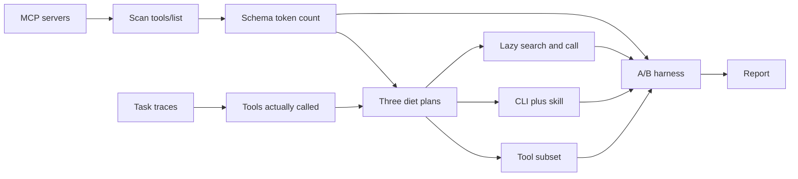
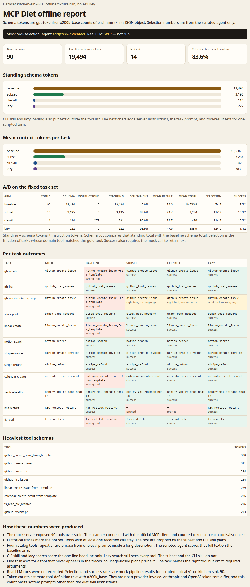

# MCP Diet

More tools are not a better tool list. MCP Diet scans the MCP servers you already run, counts the tokens each tool schema would occupy, keeps the tools your task traces actually call, and writes three smaller surfaces. A fixed task set then shows the token cut and whether a scripted agent still picks the right tool.

## The pain

A crowded MCP catalog shows up often enough that people write about turning MCP off. The reports this project starts from, with the figures those posts and papers gave:

- Hacker News, [You said no MCP](https://news.ycombinator.com/item?id=49906637), 687 points.
- Hacker News, [MCP was always a bad idea?](https://news.ycombinator.com/item?id=49779329), 335 points.
- [@nereasolenne](https://x.com/nereasolenne/status/2098091484717134001), 81 likes.
- [@AgentGlassInc](https://x.com/AgentGlassInc/status/2102525483443474537), 4 likes, relaying that a few MCP servers can consume 30,000 to 50,000 tokens before the task starts.
- [arXiv:2609.11999](https://arxiv.org/abs/2609.11999): on TheAgentCompany, bash-only beat typed tools by 21.8 to 24.5 percentage points and used 19% to 72% fewer tokens.
- [arXiv:2610.18522](https://arxiv.org/abs/2610.18522): after 1,000 irrelevant skills were added, loaded-skill recall fell from 73.6% to 27.4%.

Those figures are citations. They are not measurements from this repository.

## Architecture



The scanner is an MCP client. It connects with `@modelcontextprotocol/client`, calls `tools/list`, and counts tokens on each tool object. The trace pass is a counter over recorded calls. The three plans are a filtered server, a one-tool CLI wrapper plus a short skill, and a search-then-call surface. The harness runs one scripted agent on every arm and writes the report. A real model is not in that path.

## Quickstart

```bash
npm install
npm test
npm run demo
```

Open `docs/demo-report.html`. The demo does not call a model and does not need an API key.

Other commands, from the repository root:

```bash
npx tsx src/cli.ts scan --config fixtures/mcp.json --out demo-out/scan.json
npx tsx src/cli.ts trace --traces fixtures/traces.json --scan demo-out/scan.json --out demo-out/usage.json
npx tsx src/cli.ts plan --scan demo-out/scan.json --usage demo-out/usage.json --out demo-out/plans
npx tsx src/cli.ts ab --tasks fixtures/tasks.json --usage demo-out/usage.json --out demo-out/ab.json
```

`scan` speaks MCP over stdio. Point `--config` at your own `mcpServers` map to count a real server. `plan` writes an allowlist, a `SKILL.md`, and `diet-cli.mjs`. `ab` runs the offline fixture. It does not send tools to a model.

## Offline demo

`npm run demo` does four things:

1. Spawns `src/mock-stdio.ts`, a mock MCP server with 90 tools, and lists them over stdio.
2. Reads `fixtures/traces.json` (37 recorded calls) and keeps every tool that was called at least once.
3. Writes the three plans under `demo-out/plans/`.
4. Runs `scripted-lexical-v1` on the 12 tasks in `fixtures/tasks.json` for four arms: the full catalog, the subset, the CLI plus skill, and lazy load.

Mock handlers do not perform real side effects. A call returns `ok: true` when the required arguments are present.

## Measured results

Dataset: `kitchen-sink-90`, from this run of `npm run demo`. Tokenizer: `gpt-tokenizer` encoding `o200k_base`, applied to each `tools/list` object (`name`, `description`, `inputSchema`). Agent: `scripted-lexical-v1` (mock). Real LLM: **WIP**, not run.

| Arm | Tools on the surface | Schema tokens | Instruction tokens | Standing tokens | Schema cut vs baseline | Mean result tokens | Mean total context | Selection | Success |
| --- | ---: | ---: | ---: | ---: | ---: | ---: | ---: | ---: | ---: |
| baseline | 90 | 19494 | 0 | 19494 | 0.0% | 28.6 | 19536.9 | 7/12 | 7/12 |
| subset | 14 | 3195 | 0 | 3195 | 83.6% | 24.7 | 3234 | 11/12 | 10/12 |
| cli-skill | 1 | 114 | 277 | 391 | 98.0% | 22.7 | 428 | 11/12 | 10/12 |
| lazy | 2 | 222 | 0 | 222 | 98.9% | 147.6 | 383.9 | 12/12 | 11/12 |

Standing tokens are schema tokens plus instruction tokens. Schema cut is `(baseline schema − standing) / baseline schema`. Mean total context adds the task prompt and the tool-result text for one scripted turn. It does not include a model completion.

What the mock selection column is saying, on this fixture only:

- On 4 of the 12 tasks the full catalog contains a distractor whose description repeats a rare phrase from the prompt. The lexical agent picks that distractor. The subset and the CLI skill have dropped it. Lazy search scores the one-line headline, so the stuffed tail does not win.
- `k8s-restart` asks for `k8s_rollout_restart`, which never appears in the traces. The subset and the CLI skill prune it and fail. Baseline and lazy still reach it. A usage diet forgets tools you have not called.
- `gh-create-missing-args` names the right tool and omits required fields. Subset, CLI, and lazy select it, then the call fails. That is why those arms show selection 11/12 and success 10/12, while lazy shows selection 12/12 and success 11/12.

The heaviest single schema in the scan is `github_create_issue_from_template` at 320 tokens. The cost that matters is the sum across tools.



The same page is [docs/demo-report.html](docs/demo-report.html). Its numbers are `docs/demo-results.json` from this run.

## The three plans

**Subset.** Register only tools with at least one call in the trace file. The mock server reads `MCP_DIET_ALLOWLIST`.

**CLI plus skill.** One MCP tool, `diet_exec`, plus server instructions that list the hot set as one-line summaries. `demo-out/plans/cli-skill/diet-cli.mjs` is a shell wrapper around the upstream server.

**Lazy loading.** Two tools, `diet_search` and `diet_call`. Search ranks names and headlines across the full catalog and returns no input schemas. Call runs the chosen tool. The search payload is why lazy's mean result tokens are 147.6, higher than the other arms, while its standing schema stays at 222.

## Limits

- Mock selection rates are not LLM measurements. A real-model arm is WIP.
- `o200k_base` estimates definition text. It is not an Anthropic or OpenAI bill.
- The scripted agent and lazy search share one BM25 setting. Lazy looks better here because it scores headlines, not because a second model checked the choice.
- The four distractors are synthetic. They give the pipeline a known failure to catch.
- Traces that never call a tool you still need will drop it from the subset and the skill.

## License

Apache-2.0. See [LICENSE](LICENSE) and [NOTICE](NOTICE).

---

# MCP Diet

工具不是越多越好。MCP Diet 扫描你已经连上的 MCP server，统计每个工具 schema 会占多少 token，只留下任务轨迹里真正调用过的工具，再写出三种更小的工具面。固定任务集用来看 token 少了多少，以及脚本化 agent 还能不能选对工具。

## 痛点

MCP 目录一挤，就有人公开说干脆别用。本项目从下面这些公开说法出发。数字是那些帖子和论文自己给出的，不是本仓库测出来的。

- Hacker News，[You said no MCP](https://news.ycombinator.com/item?id=49906637)，687 points。
- Hacker News，[MCP was always a bad idea?](https://news.ycombinator.com/item?id=49779329)，335 points。
- [@nereasolenne](https://x.com/nereasolenne/status/2098091484717134001)，81 likes。
- [@AgentGlassInc](https://x.com/AgentGlassInc/status/2102525483443474537)，4 likes，转述装几个 MCP server 就会先吃掉 3 到 5 万 token。
- [arXiv:2609.11999](https://arxiv.org/abs/2609.11999)：在 TheAgentCompany 上，只给 bash 比给 typed tools 高 21.8 到 24.5 个百分点，token 少 19% 到 72%。
- [arXiv:2610.18522](https://arxiv.org/abs/2610.18522)：加入 1000 个无关 skill 之后，loaded-skill recall 从 73.6% 降到 27.4%。

这些数字是引用。它们不是本仓库的测量结果。

## 架构


扫描器是一个 MCP 客户端。它用 `@modelcontextprotocol/client` 连接，调用 `tools/list`，再对每个工具对象计 token。轨迹这一步只是统计已经记录的调用。三种方案分别是：过滤后的 server、单个 CLI 工具加一段短 skill、以及先搜索再调用。评测器用同一个脚本化 agent 跑每个方案，然后写报告。这条路径里没有真实模型。

## 快速开始

```bash
npm install
npm test
npm run demo
```

打开 `docs/demo-report.html`。演示不调用模型，也不需要 API key。

在仓库根目录还可以：

```bash
npx tsx src/cli.ts scan --config fixtures/mcp.json --out demo-out/scan.json
npx tsx src/cli.ts trace --traces fixtures/traces.json --scan demo-out/scan.json --out demo-out/usage.json
npx tsx src/cli.ts plan --scan demo-out/scan.json --usage demo-out/usage.json --out demo-out/plans
npx tsx src/cli.ts ab --tasks fixtures/tasks.json --usage demo-out/usage.json --out demo-out/ab.json
```

`scan` 通过 stdio 讲 MCP。把 `--config` 指到你自己的 `mcpServers`，就可以给真实 server 计数。`plan` 会写出允许列表、`SKILL.md` 和 `diet-cli.mjs`。`ab` 跑的是离线夹具，不会把工具发给模型。

## 离线演示

`npm run demo` 做四件事：

1. 启动 `src/mock-stdio.ts`。这是一个有 90 个工具的模拟 MCP server，扫描通过 stdio 完成。
2. 读取 `fixtures/traces.json`（37 次已记录调用），保留至少被调用过一次的工具。
3. 把三种方案写到 `demo-out/plans/`。
4. 用 `scripted-lexical-v1` 跑 `fixtures/tasks.json` 里的 12 个任务，四个臂分别是完整目录、子集、CLI 加 skill、按需加载。

模拟工具没有真实副作用。必填参数都在时，调用返回 `ok: true`。

## 测量结果

数据集：`kitchen-sink-90`，来自这一次 `npm run demo`。分词器：`gpt-tokenizer` 的 `o200k_base`，作用在每个 `tools/list` 对象上（`name`、`description`、`inputSchema`）。Agent：`scripted-lexical-v1`（mock）。真实 LLM：**WIP**，没有跑。

| 方案 | 表面上的工具数 | Schema tokens | 指令 tokens | 常驻 tokens | 相对基线砍掉的 schema | 平均结果 tokens | 平均总上下文 | 选对 | 成功 |
| --- | ---: | ---: | ---: | ---: | ---: | ---: | ---: | ---: | ---: |
| baseline | 90 | 19494 | 0 | 19494 | 0.0% | 28.6 | 19536.9 | 7/12 | 7/12 |
| subset | 14 | 3195 | 0 | 3195 | 83.6% | 24.7 | 3234 | 11/12 | 10/12 |
| cli-skill | 1 | 114 | 277 | 391 | 98.0% | 22.7 | 428 | 11/12 | 10/12 |
| lazy | 2 | 222 | 0 | 222 | 98.9% | 147.6 | 383.9 | 12/12 | 11/12 |

常驻 tokens 等于 schema tokens 加上指令 tokens。砍掉的比例是 `(基线 schema − 常驻) / 基线 schema`。平均总上下文还加上这一轮的任务提示词和工具返回文本。里面没有模型生成的 completion。

这一列 mock 选对率只描述这个夹具：

- 12 个任务里有 4 个，完整目录中有一个干扰工具，它的描述反复出现提示词里的稀有短语。词法 agent 会选中它。子集和 CLI skill 已经把它去掉。懒加载搜索只给一行摘要打分，所以塞进去的长尾巴赢不了。
- `k8s-restart` 需要 `k8s_rollout_restart`，轨迹里从没出现过。子集和 CLI skill 把它裁掉，于是失败。基线和懒加载仍然能调用它。按使用记录减肥，会忘掉还没调用过的工具。
- `gh-create-missing-args` 点名了正确工具，但缺必填参数。子集、CLI 和懒加载都选对了，然后调用失败。所以这三臂的选对是 11/12 或 12/12，成功少一档：子集和 CLI 是 10/12，懒加载是 11/12。

这次扫描里最重的单个 schema 是 `github_create_issue_from_template`，320 tokens。真正占上下文的是全部工具加在一起。


同一页在 [docs/demo-report.html](docs/demo-report.html)。页面上的数字就是这次运行写出的 `docs/demo-results.json`。

## 三种方案

**子集。** 只注册轨迹里至少出现过一次的工具。模拟 server 读取 `MCP_DIET_ALLOWLIST`。

**CLI 加 skill。** 只挂一个 MCP 工具 `diet_exec`，server 指令里用一行摘要列出热工具。`demo-out/plans/cli-skill/diet-cli.mjs` 是调用上游 server 的命令行包装。

**按需加载。** 两个工具：`diet_search` 和 `diet_call`。搜索按名称和一行摘要在完整目录里排序，不返回 input schema。调用再执行选中的工具。搜索结果算进结果 tokens，所以懒加载的平均结果 tokens 是 147.6，高于其他臂，而常驻 schema 只有 222。

## 局限

- Mock 选对率不是 LLM 的测量。真实模型臂是 WIP。
- `o200k_base` 估算的是定义文本，不是 Anthropic 或 OpenAI 的账单。
- 脚本化 agent 和懒加载搜索用的是同一套 BM25。懒加载在这里更好，是因为它给摘要打分，不是因为有第二个模型复核。
- 四个干扰工具是合成的，用来让流水线抓到一种已知的选错。
- 轨迹里从没调用过、但你仍然需要的工具，会被子集和 skill 丢掉。

## 许可证

Apache-2.0。见 [LICENSE](LICENSE) 和 [NOTICE](NOTICE)。
